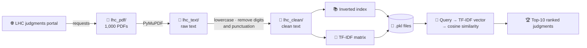
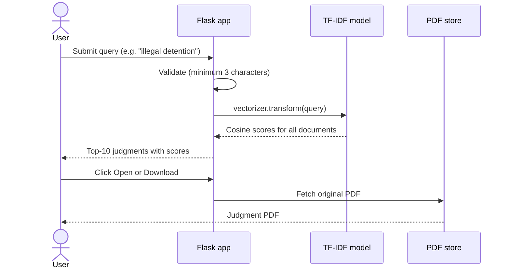

<div align="center">

<a href="#-pipeline"></a>

<br/>


</div>

---

## 📌 Overview

Finding a relevant precedent among thousands of court judgments is slow when all you have is a folder of PDFs. This project builds a **complete search engine for Lahore High Court (LHC) judgments**, from collecting the documents to ranking them for a user's query.

It scrapes judgment PDFs from the LHC public judgments portal, converts them to text, cleans and indexes them, and ranks documents with **TF-IDF + cosine similarity**. Users search through a **Flask web app** that shows the top-10 matches with their relevance scores and lets them open or download the original judgment.

<table>
<tr>
<td align="center"><b>1,000</b><br/>judgments</td>
<td align="center"><b>13</b><br/>pipeline steps</td>
<td align="center"><b>3</b><br/>interfaces<br/><sub>web · desktop · CLI</sub></td>
<td align="center"><b>Top-10</b><br/>ranked results</td>
<td align="center"><b>1-click</b><br/>open / download PDF</td>
</tr>
</table>

---

## ✨ Highlights

<table>
<tr>
<td width="50%"><a href="#-pipeline"></a></td>
<td width="50%"><a href="#-ir-techniques-implemented"></a></td>
</tr>
<tr>
<td width="50%"><a href="#how-a-search-request-flows"></a></td>
<td width="50%"><a href="#-interfaces"></a></td>
</tr>
</table>

---

## 🔄 Pipeline



### How a search request flows



---

## 🧰 IR Techniques Implemented

The project is built as a step-by-step series of scripts, each adding one classical IR building block:

| Step | Script | What it does |
|:--:|:--|:--|
| 1 | `Step_1_Scrap.py` | Downloads judgment PDFs from the LHC public portal |
| 2 | `Step_2_pdf_to_text.py` | Extracts text from every PDF with PyMuPDF |
| 3 | `Step_3_Cleaning.py` | Lowercases, removes digits and punctuation, normalises whitespace |
| 4 | `Step_4_Indexing.py` | Builds an inverted index (term → document IDs) |
| 5 | `Step_5_Bool.py` | Boolean retrieval with AND / OR / NOT (demonstrated on a sample index) |
| 6 | `Step_6_phrase_matching.py` | Exact phrase search over the cleaned corpus |
| 7 | `Step_7_wildcard_query.py` | Prefix wildcard matching such as `viol*` (demonstrated on a sample index) |
| 8 | `Step_8_TFIDF.py` | TF-IDF vectorisation of the whole corpus |
| 9 | `Step_9_cosine_similarity.py` | Ranks documents by cosine similarity to a query |
| 10 | `Step_10_save_results.py` | Persists the vectorizer, TF-IDF matrix, document names and inverted index |
| 11 | `Step_11_load_and_search.py` | Loads the saved model and runs a search |
| 12 | `Step_12_final_search.py` | Interactive command-line search (top-5) |
| 13 | `Step_13_search_ui.py` | Tkinter desktop search app (top-10) |
| — | `app.py` | **Flask web app** with ranked results, open and download actions |

---

## 💻 Interfaces

| Interface | Entry point | Highlights |
|:--|:--|:--|
| 🌐 **Web app** | `app.py` + `templates/` + `static/` | Ranked table, relevance score, open PDF in browser, download PDF |
| 🖱️ **Desktop app** | `Step_13_search_ui.py` | Dark-themed Tkinter window, top-10 results with scores |
| ⌨️ **CLI** | `Step_12_final_search.py` | Fast terminal search loop, type `exit` to quit |

All three reject queries shorter than 3 characters and hide documents with zero similarity, so users never see irrelevant noise.

<!--
  Tip: add a screenshot or GIF of the web app here, e.g.
  
-->

---

## 🚀 Getting Started

```bash
git clone https://github.com/RamzanPUCIT/lhc-legal-information-retrieval-system.git
cd lhc-legal-information-retrieval-system
pip install requests pymupdf scikit-learn flask
```

```bash
python Step_1_Scrap.py            # 1. download judgments into lhc_pdf/
python Step_2_pdf_to_text.py      # 2. extract text into lhc_text/
python Step_3_Cleaning.py         # 3. clean text into lhc_clean/
python Step_10_save_results.py    # 4. build TF-IDF + inverted index, save .pkl files
python app.py                     # 5. start the web app → http://127.0.0.1:5000
```

> [!NOTE]
> Judgment PDFs, extracted text and the generated `.pkl` model files are git-ignored, so run steps 1–4 once before starting the app. Please keep the scraping rate modest out of respect for the court's public server.

---

## 🗂️ Repository Structure

```
lhc-legal-information-retrieval-system/
├── Step_1_Scrap.py ... Step_13_search_ui.py   # Step-by-step IR pipeline
├── app.py                                      # Flask web application
├── templates/
│   └── index.html                              # Search page
├── static/
│   └── style.css                               # Styling
├── .gitignore
├── assets/readme/                              # Animated README graphics (SVG)
└── README.md
```

---

## 🔭 Future Work

- [ ] Evaluate ranking quality with a labelled query set (Precision@k, MAP, nDCG)
- [ ] Add BM25 and compare it against TF-IDF
- [ ] Dense retrieval with legal-domain sentence embeddings, then hybrid (sparse + dense) search
- [ ] Retrieval-Augmented Generation: an LLM assistant that answers legal questions and cites the retrieved judgments
- [ ] Containerise with Docker and deploy as a public demo

---

## 👨‍💻 Author

**Muhammad Ramzan** · M.Phil Artificial Intelligence, PUCIT (University of the Punjab), Lahore

[](https://linkedin.com/in/ramzan-ai)
[](https://github.com/RamzanPUCIT)
[](mailto:founders786@gmail.com)

<div align="center">

⭐ **If this project helped you, consider giving it a star!** ⭐


</div>
